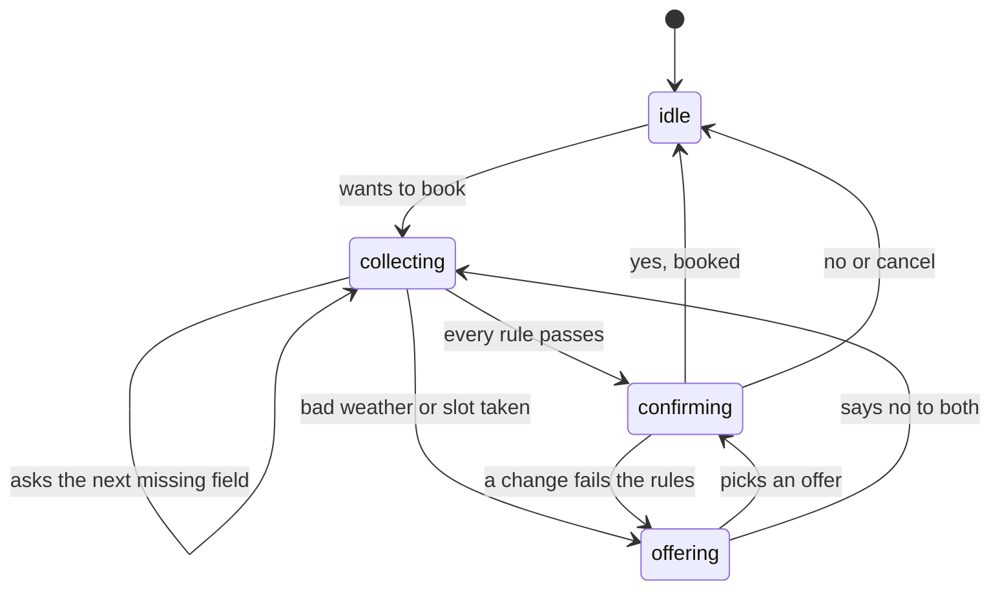

# Sarjy

Sarjy is a voice assistant that books outdoor plans: a padel court, a football pitch or a coffee shop table, in any city. Before it commits, it checks the hourly forecast for the exact hours you want. If it's too hot, too cold, too windy or likely to rain, it offers something that works instead: the indoor venue at the same time, or the outdoor one at a better hour.
- **Live demo:** https://sarjy-beige.vercel.app
- **Repository:** https://github.com/Yokozuna59/sarjy

The venues are fictional and labelled "Sample venue". Nothing is really booked.

## What it does

- **Talk or type.** Tap the mic and talk hands-free. Sarjy hears when you stop, answers out loud sentence by sentence, and stops when you interrupt.
- **Remembers you.** Your name, city or favorite color carry over to every new chat, and the start screen shows what Sarjy knows.
- **Books with a real weather check.** Feels-like temperature, wind and rain chance, for every hour the booking covers, in that city's local time.
- **Handles going off-script.** Side questions, corrections, picking an offer or cancelling, at any step.
- **Shows its work.** A strip above the text box fills in as you talk, and each booking ends with a card that shows the forecast it passed.

## Try it

Tap an example on the start screen, or try this tour:
1. "Hi, my name is Sara, and my favorite color is green."
2. "Book a padel court in London tomorrow at 4 PM for 4 people." (Pick a rainy or cold city that day to see the alternatives.)
3. "Will it rain at those times?" (A side question. Sarjy answers, then says "Back to your booking.")
4. "Make it Riyadh instead." (A correction. Every rule runs again.)
5. "Yes." Then open New chat and ask "What's my favorite color?"

Headphones work best for voice, so Sarjy doesn't hear itself.

## How it works


- **One Next.js app on Vercel, with a stateless server.** The browser keeps the chat, memories, booking progress and bookings, and sends what each turn needs.
- **Voice in:** the Silero voice detection model runs in the browser. When you stop talking, the clip goes to `/api/turn` and OpenAI `gpt-4o-mini-transcribe` turns it into text.
- **Understanding:** one OpenAI `gpt-6-luna` call per turn returns strict JSON, validated with Zod: booking intent and fields, facts to remember, and any side question.
- **Voice out:** the reply is split into sentences and each one is spoken by OpenAI `gpt-4o-mini-tts`, so the first sentence plays while the rest are made.

## Deep dive: multistep workflows

**The engine owns the booking, not the LLM.** The LLM turns what you said into strict JSON and answers small talk. A plain TypeScript engine (`src/engine/`) checks every answer, decides what happens next, and phrases each step from templates, so every number Sarjy says comes from real data. The engine imports nothing from Next.js, React or OpenAI. Venues, bookings, the time and the weather reach it through a `ctx` argument.

### State

```ts
interface FlowState {
  status: "idle" | "collecting" | "offering" | "confirming";
  fields: Fields; // activity, city, date, time, group_size, booking_name
  pending: Field | null; // the field Sarjy just asked for
  offers: Slot[]; // alternatives on the table
  draft: Booking | null; // the booking waiting for "yes"
}
```

The state is data, not a conversation. It goes with every turn, so a reload continues the booking, and the strip above the text box draws it live.



### One turn: `step(state, input, ctx)`

1. **Merge** what you said. Corrections overwrite, so "make it Thursday" just replaces the date.
2. **Fill from memory:** your name for the booking, and your city if Sarjy knows it.
3. **Check each value:** the city must exist, the date must be within the 7-day forecast, and times are on the hour.
4. **Ask** for the first missing field, in the order set by the flow spec (`src/engine/flows/book-venue.ts`). Football skips the group size, since a pitch is booked whole.
5. **Check the slot:** not in the past (in the city's time zone), fits the group, inside opening hours, not double-booked, and for outdoor venues, good weather for every hour it covers.
6. **Decide:** confirm, ask again with the reason, or offer alternatives.
7. **On "yes",** check everything once more, then book.

Limits live in `src/engine/config.ts`: feels like 5 to 35 °C, wind up to 30 km/h, rain chance up to 40%.

### Alternatives, not a plain no

When a slot fails, Sarjy checks every open hour that day at each venue for the activity, plus the same slot the next day, and offers the closest slot plus the closest outdoor one: "The chance of rain is 100 percent. I can do Indoor Padel Club today at 2 PM, or Open-air Padel Courts today at 11 AM." It never switches venue on its own.

### Going off-script

| You say                                                | What happens                                                                              |
| ------------------------------------------------------ | ----------------------------------------------------------------------------------------- |
| A side question mid-booking ("Will it rain at 11 AM?") | Sarjy answers from real data, says "Back to your booking.", and repeats the current step. |
| A correction ("make it 9 PM", "in Riyadh instead")     | The field is replaced and every rule runs again, weather included.                        |
| "The second one", or "yes" to a single offer           | The offer is adopted and confirmed.                                                       |
| "No" to the offers, or "cancel" at any step            | Sarjy asks for another time, or drops the booking.                                        |
| An Arabic or misheard city name                        | It's mapped to the likely city. Places that don't exist get "I couldn't find that city."  |
| A pause in the middle of a sentence                    | The second half waits for the first turn, so it's read with the new state.                |

### Details that keep it reliable

- **Strict JSON, ordered on purpose.** The booking object comes first in the schema, extraction runs at temperature 0, and a token cap stops any runaway reply in seconds.
- **Short answers fill the right field.** A bare "4 p.m." fills the time when that's what Sarjy just asked.
- **Real cities only.** Geocoding accepts only places with a known population, so a misheard name never lands on a village with the same name.
- **Every booking is checked twice.** The rules run when Sarjy confirms and again on "yes".

## Why Open-Meteo

Weather is what turns a booking into a decision. Sarjy needs the hourly feels-like temperature, wind and rain chance at the exact hours of a booking, in any city, plus a way to turn a spoken city name into coordinates and a time zone. Open-Meteo gives all of that from one free, key-free service, so the reviewer needs no setup and the demo uses real weather anywhere in the world.

## Run it locally

You need Node 24 and pnpm.

```bash
pnpm install
cp .env.example .env   # then set OPENAI_API_KEY
pnpm dev               # http://localhost:3000
```

`pnpm lint` and `pnpm typecheck` run the checks.

## Project structure

```text
src/
  app/            the page, plus /api/turn and /api/tts
  components/     chat UI, start screen, mic button, booking card,
                  booking progress strip
  hooks/          chat state, voice detection, speaker, browser storage
  engine/         the flow engine: types, config, flow spec, rules,
                  alternatives, step, templates
  data/           the six sample venues, passed to the engine through ctx
  services/       one file per external API: OpenAI (speech, LLM,
                  voice) and Open-Meteo
  lib/            the turn's reply logic, time helpers, shared types
```

## Credits

- Weather data by [Open-Meteo.com](https://open-meteo.com/) (CC BY 4.0).
- Speech, language and voice by OpenAI.
- Voice detection by [@ricky0123/vad](https://github.com/ricky0123/vad) with the Silero VAD model.
