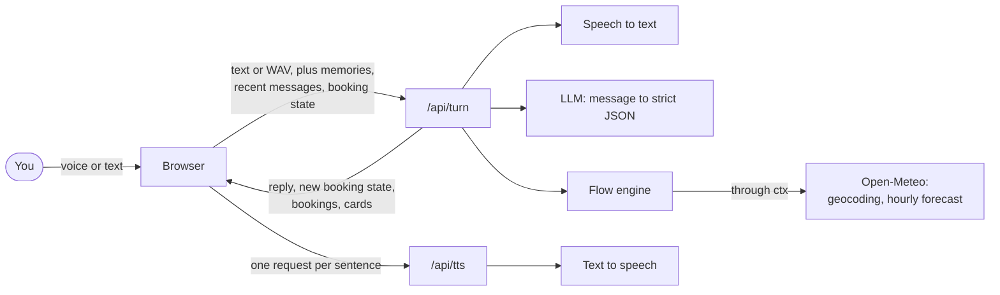
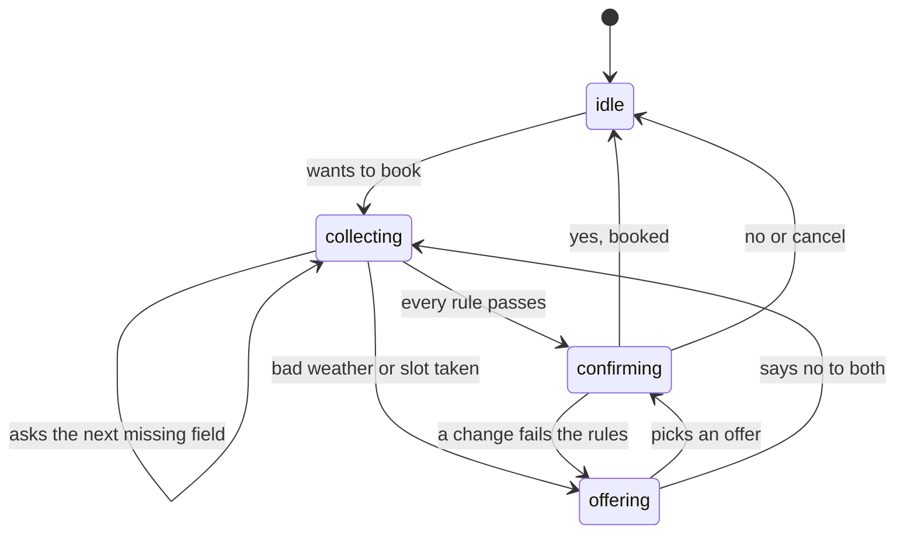

# Sarjy

Sarjy is a voice assistant that books outdoor plans: a padel court, a football pitch or a coffee shop table, in any city. Before it commits, it checks the hourly forecast for the exact hours you want. If it's too hot, too cold, too windy or likely to rain, it offers something that works instead: the indoor venue at the same time, or the outdoor one at a better hour.
- **Live demo:** https://sarjy-beige.vercel.app
- **Repository:** https://github.com/Yokozuna59/sarjy

The venues are fictional and labelled "Sample venue". Nothing is really booked.

## What it does

- **Talk or type.** Tap the mic and talk hands-free. Sarjy detects when you stop, answers out loud sentence by sentence, and stops talking when you start. Headphones work best.
- **Remembers you.** Tell it your name or your city, and it remembers in later chats. "What's my name?" works after New chat. Forget me clears everything.
- **Books with a real weather check.** It checks feels-like temperature, wind and rain chance for every hour the booking covers, in the city you choose and in that city's local time.
- **Handles going off-script.** Ask about the weather mid-booking, change your mind, pick an offer, or cancel, and it keeps track.
- **Shows booking cards** after a booking and when you ask "What have I booked?"

## Try it

1. "Hi, my name is Sara."
2. "Book a padel court in London tomorrow at 4 PM for 4 people." (Pick a rainy or cold city that day. Sarjy explains why the outdoor slot fails and offers alternatives.)
3. "Will it rain at those times?" (A side question. Sarjy answers for the offered hours, then says "Back to your booking.")
4. "Make it Riyadh instead." (A correction. It checks everything again.)
5. "Yes." Then: "What have I booked?"
6. Open New chat and ask "What's my name?"

## How it works



- **One Next.js app on Vercel.** The server is stateless. The browser keeps the chat, memory facts, booking progress and bookings in `localStorage`, and sends what a turn needs.
- **Voice in:** `@ricky0123/vad-react` runs the Silero voice detection model in the browser. When you stop talking, the clip goes to `/api/turn` as a WAV file and OpenAI `gpt-4o-mini-transcribe` turns it into text.
- **Understanding:** one OpenAI `gpt-6-luna` call per turn returns strict JSON, checked with Zod: booking intent and fields, facts to remember, and any side question.
- **Voice out:** the reply is split into sentences. The browser asks `/api/tts` for each one (OpenAI `gpt-4o-mini-tts`, voice `marin`), so the first sentence plays while the rest are made. If that fails, it falls back to the browser's own voice.

## Deep dive: multistep workflows

The brief asked how Sarjy keeps state and recovers when the user goes off-script. My answer: **the engine owns the booking, not the LLM.**

The LLM does two narrow jobs. It turns what you said into strict JSON, and it writes one-line answers to small talk and memory questions. It never decides a booking, invents a number or phrases a booking step. A plain TypeScript engine (`src/engine/`) checks every answer and decides what happens next, and templates do the phrasing. The engine imports nothing from Next.js, React or OpenAI, and never calls `fetch`. Venues, bookings, the time and the weather reach it through a `ctx` argument.

### State

```ts
interface FlowState {
  status: "idle" | "collecting" | "offering" | "confirming";
  fields: Fields; // activity, city, date, time, group_size, booking_name, setting
  pending: Field | null; // the field Sarjy just asked for
  offers: Slot[]; // alternatives on the table
  draft: Booking | null; // the booking waiting for "yes"
}
```

The state is data, not a conversation. It lives in the browser and goes with every turn, so a reload continues the booking.



### One turn: `step(state, input, ctx)`

1. **Merge** what you said into the fields. Corrections overwrite, so "make it Thursday" just replaces the date.
2. **Fill from memory:** your name for the booking, and your city if Sarjy knows it.
3. **Check each new value:** the city must exist (Open-Meteo geocoding), the date must be within the 7-day forecast, and times are on the hour.
4. **Ask** for the first missing field, in the order set by the flow spec (`src/engine/flows/book-venue.ts`).
5. **Check the slot** against every rule: not in the past (in the city's time zone), fits the group, inside opening hours, not overlapping another booking, and for outdoor venues, good weather for every hour it covers.
6. **Decide:** confirm, ask again with the reason, or offer alternatives.
7. **On "yes",** check the slot once more, then book.

The rules and limits live in `src/engine/config.ts`: feels like 5 to 35 °C, wind up to 30 km/h, rain chance up to 40%. Padel and football last 60 minutes, coffee 90.

### Alternatives, not a plain no

When the weather fails or the slot is taken, Sarjy looks at every open hour that day at each venue for the activity, plus the same slot the next day. It keeps only slots that pass every rule, and offers the closest one plus the closest outdoor one: "The chance of rain is 100 percent. I can do Indoor Padel Club today at 2 PM, or Open-air Padel Courts today at 11 AM." It never switches venue on its own. If nothing works that day, it asks for another day.

### Going off-script

| You say                                                  | What happens                                                                                                                                                    |
| -------------------------------------------------------- | --------------------------------------------------------------------------------------------------------------------------------------------------------------- |
| A side question mid-booking ("Will it rain at 11 AM?")   | Sarjy answers from fetched data, says "Back to your booking.", and repeats the current step. Weather questions default to the booking's city and offered times. |
| A correction ("make it 9 PM", "in Riyadh instead")       | The field is replaced and every rule runs again, weather included.                                                                                              |
| "The second one", or "yes" to a single offer             | The offer is adopted and confirmed.                                                                                                                             |
| "No" to the offers                                       | Sarjy asks for another time.                                                                                                                                    |
| "Cancel" at any step                                     | The booking in progress is dropped.                                                                                                                             |
| A city that doesn't exist, or an Arabic or misheard name | Arabic and misheard names are mapped to the likely city. Unknown places get "I couldn't find that city."                                                        |
| A pause in the middle of a sentence                      | Speech that ends while a turn is still running waits for it, so it's read with the new state.                                                                   |

### What testing taught me

- **Strict JSON can run away.** With the booking object last in the schema, the model sometimes kept writing whitespace after the JSON until it ran out of tokens, so the request hung (4 of 5 tries). Putting it first fixed it in every run since, and a 500-token cap stops any future runaway in seconds.
- **Temperature 0 for extraction.** At the default temperature, a bare "4 p.m." was sometimes left empty (3 of 6 tries).
- **The first geocoding match isn't always right.** Arabic "الخبر" (Al Khobar) once came back from speech-to-text as "الكبر", and the first match was a village in Yemen. Now only places with a known population count as cities.

## Why Open-Meteo

Weather is what turns a booking into a decision. Sarjy needs the hourly feels-like temperature, wind and rain chance at the exact hours of a booking, in any city, plus a way to turn a spoken city name into coordinates and a time zone. Open-Meteo gives all of that from one free, key-free service (forecast and geocoding), so the reviewer needs no setup and the demo can use real weather anywhere in the world.

## Data model

Everything is stored per browser, so availability isn't shared between visitors.

| `localStorage` key | Contents                                                                                          |
| ------------------ | ------------------------------------------------------------------------------------------------- |
| `sarjy:messages`   | The chat: `{ id, role, text, cards? }[]`                                                          |
| `sarjy:memories`   | Facts about you, like `{ name: "Sara", city: "Riyadh" }`. Kept by New chat, cleared by Forget me. |
| `sarjy:flow`       | The `FlowState` above. Cleared by New chat.                                                       |
| `sarjy:bookings`   | `{ venueId, city, date, hour, minutes, groupSize, name }[]`                                       |

Dates are `YYYY-MM-DD`, and booking hours are local to the booking's city.

## Testing and latency

- **No automated tests in this version.** I wrote unit tests for the engine early on, then removed them to spend the time on features. Every change was checked by hand on a local production build, with scripted conversations against the real APIs (rain in Manchester, cold in Glasgow, no outdoor slot all day in Bergen, unknown cities, side questions, corrections, Arabic city names), then in the browser.
- **Latency,** measured on a production build: about 1.7 to 2.3 seconds from the end of speech to Sarjy's voice, including the 0.5 second wait for silence. Text turns take about 1.2 to 3.5 seconds.
- **Cost:** a full day of testing used about $0.25 of OpenAI credit.

## Trade-offs and what I'd do with another week

- **Groq sign-up failed, so I switched to OpenAI,** and only the service files changed. `OPENAI_BASE_URL` can still point the same SDK at Groq.
- **Data lives in the browser instead of PostgreSQL,** to protect time for the flow engine. The Postgres schema is designed, and it would be the first thing to add, along with shared availability across visitors.
- **English only for now.** The engine already returns actions, not sentences, so Saudi Arabic needs new templates and a voice setting, not engine changes.
- **Tests:** bring back engine unit tests, add CI, and add a live suite of scripted conversations with a pass rate.
- **Known gaps:** a half-second pause can split a sentence into two turns. iPhone Safari may block Sarjy's voice until you tap. You can't yet cancel a booking once it's made.

## Run it locally

You need Node 24 and pnpm.

```bash
pnpm install
cp .env.example .env   # then set OPENAI_API_KEY
pnpm dev               # http://localhost:3000
```

`pnpm lint` and `pnpm typecheck` run the checks. The model names and voice can be changed with the optional variables in `.env.example`.

## Project structure

```text
src/
  app/            the page, plus /api/turn and /api/tts
  components/     chat UI, mic button, booking card
  hooks/          chat state, voice detection, speaker, browser storage
  engine/         the flow engine: types, config, venues, flow spec,
                  rules, alternatives, step, templates
  services/       one file per external API: OpenAI (speech, LLM,
                  voice) and Open-Meteo
  lib/            the turn's reply logic, time helpers, shared types
```

## Credits

- Weather data by [Open-Meteo.com](https://open-meteo.com/) (CC BY 4.0).
- Speech, language and voice by OpenAI.
- Voice detection by [@ricky0123/vad](https://github.com/ricky0123/vad) with the Silero VAD model.
